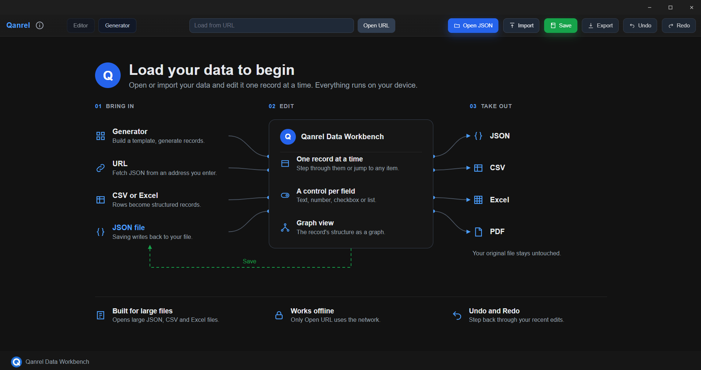
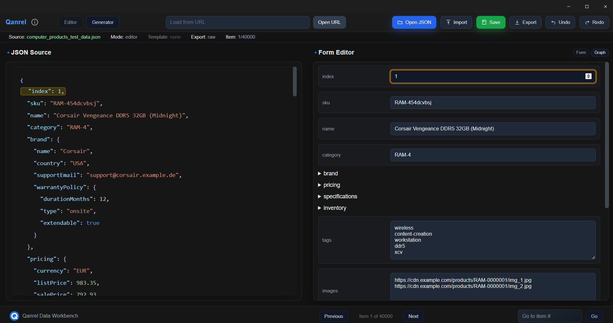
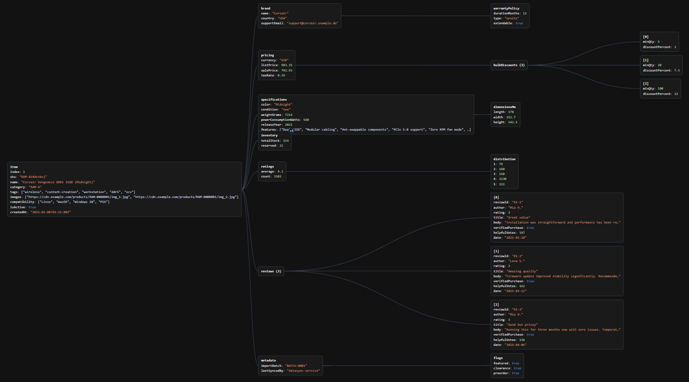

# Qanrel Data Workbench

An offline desktop application for Windows to open, edit, import and export large structured datasets (JSON, CSV and Excel), one record at a time.



## What it does

- **One record at a time.** Step through your records or jump to any item.
- **A control per field.** Text, number, checkbox or list, so you edit data in a form instead of raw text.
- **Graph view.** See the structure of the current record as a graph.
- **Generator.** Build a template and generate records from it.
- **Import and export.** Bring in JSON, URL, CSV or Excel. Take out JSON, CSV, Excel or PDF.
- **Undo and Redo.** Step back through your recent edits.
- **Works offline.** Everything runs on your device.





## Download and install

1. Open the **Releases** section of this repository.
2. Download one of the two files of the latest release:
   - `Qanrel.Data.Workbench.Setup.1.0.0.exe`: the installer.
   - `Qanrel.Data.Workbench.1.0.0.Portable.exe`: runs without installing.
3. Start the file and follow the steps.

## Windows warning when you start the file

The installer is not digitally signed yet. Because of this, Windows may show a blue window called "Windows protected your PC" and name the publisher as unknown. This is expected for software without a code-signing certificate and does not mean the file is dangerous.

To continue, click **More info** and then **Run anyway**.

If you want to be sure that your download is the original file, compare its SHA-256 hash with the table below. In Windows PowerShell, run this command with the path to your file:

```
Get-FileHash "C:\path\to\Qanrel.Data.Workbench.Setup.1.0.0.exe" -Algorithm SHA256
```

| File | SHA-256 |
|---|---|
| Qanrel.Data.Workbench.Setup.1.0.0.exe | 74D346C46D4F40CA9672D14D288129CB25D23699AFD6894775A17951EC54BB7F |
| Qanrel.Data.Workbench.1.0.0.Portable.exe | 2133F32B40B16D4BE384CEBED4C3038B63BF4CBD23CDC6B285A238B109B0DAE2 |

## Before you edit a file: make a copy

When you open a JSON file and press Save, your changes are written back into that same file. Always make a copy of your file before you start editing.

Import (CSV or Excel) and Export never change the original file.

## License

All features are available to everyone. Nothing is locked.

- **Free:** private use, and use by students and in education (teaching and learning).
- **Commercial license required:** any use that earns money (including freelance work), use for an employer or for customers, and use by non-profit organizations and NGOs, except for education.

Commercial licenses are requested by email: qanrel.software@gmail.com

A license is a file that you activate in the application under the info button (the circle with an "i" in the top bar), then **Enter License...**. The full license agreement and privacy policy are in the same dialog.

## Privacy

Your data stays on your device. The only network request the application makes is **Open URL**, which you start yourself by entering an address.

## Limits

These limits protect the application from running out of memory. The application tells you clearly when a file is too large.

- Open JSON: files up to 500 MB.
- Save: works as long as the saved file stays under 500 MB. In practice this means source files up to roughly 250 MB.
- Import CSV: files up to 350 MB. Very large files can take a minute or more.
- Import Excel (.xlsx): files up to 180 MB, first sheet only.
- Export Excel: datasets up to 180 MB.
- Open URL: responses up to 400 MB.
- Undo: your last 99 edits since the file was loaded.

## Support

For questions, license requests and bug reports, write to qanrel.software@gmail.com

## About this repository

This repository contains the release files and this description only. The source code is not published.

Copyright (c) 2026 Reza Kouhpayeh
